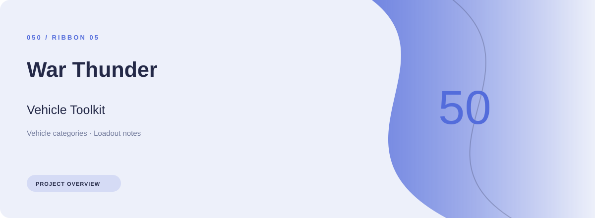
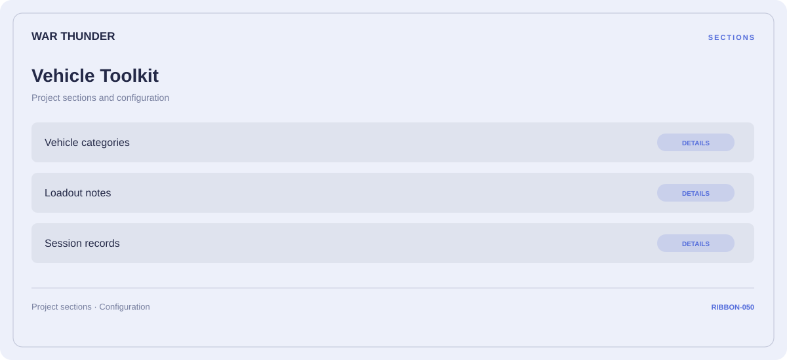

# ⚡ War Thunder Vehicle Toolkit

**Vehicle categories · Loadout notes · Session records**

## ⚡ Features

A task-oriented War Thunder vehicle toolkit workspace: vehicle categories first, loadout notes next, and session records as the final reference area.

### ⚙️ Vehicle categories

A dedicated section for vehicle categories and the configuration details associated with that area.

### 🧩 Loadout notes

Equipment categories and the associated selection or configuration options.

### ⌨️ Session records

Session and activity information grouped by the task or context it belongs to.

## 🖥️ Project navigation

## 📥 Download

The button and cover open the project's download page. Use the information supplied with the downloaded package for installation and release-specific requirements.

## 📚 Project documentation

- [Feature reference](docs/FEATURES.md)
- [Download information](docs/DOWNLOAD.md)
- [Project page](index.html)

---

War Thunder Vehicle Toolkit · Program documentation and download information.
